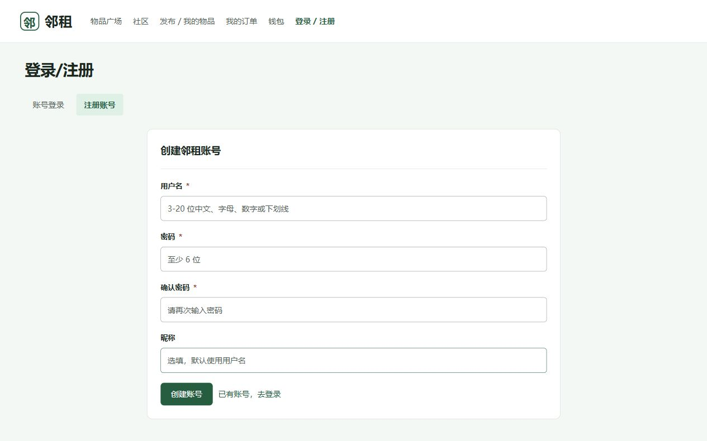
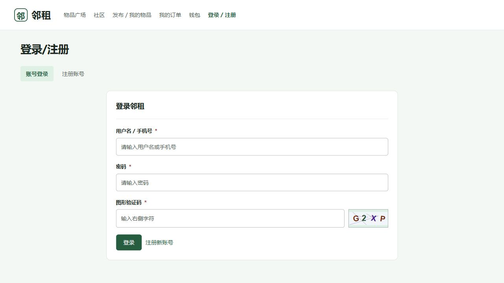
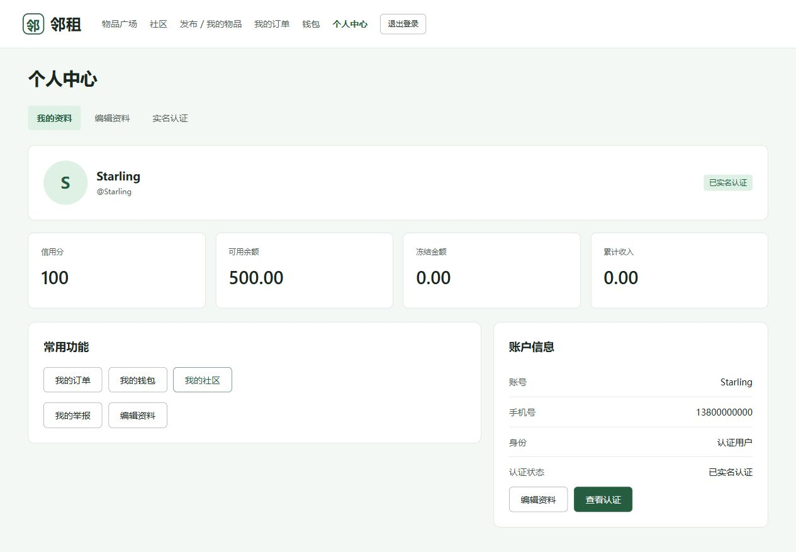
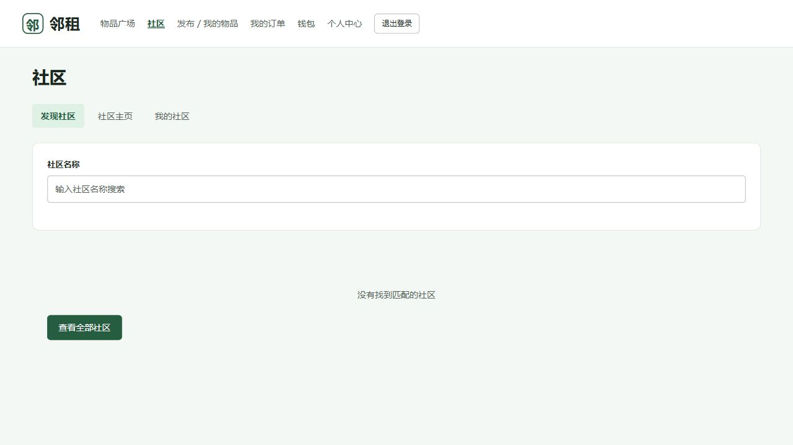
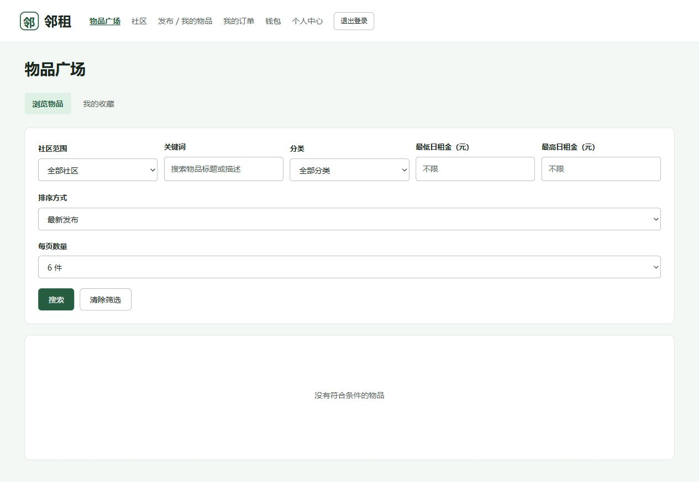
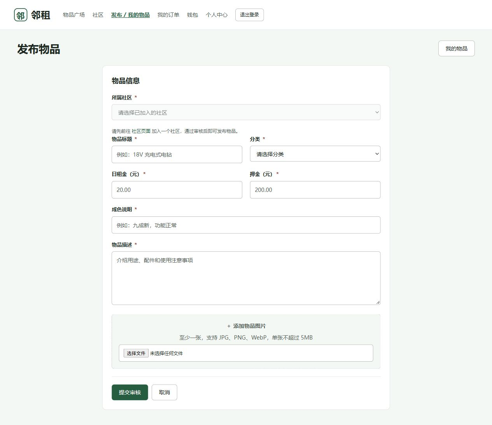
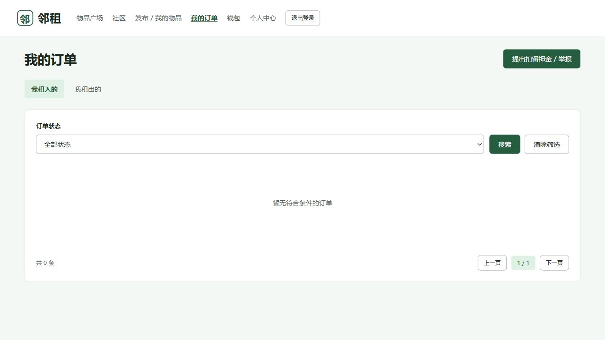
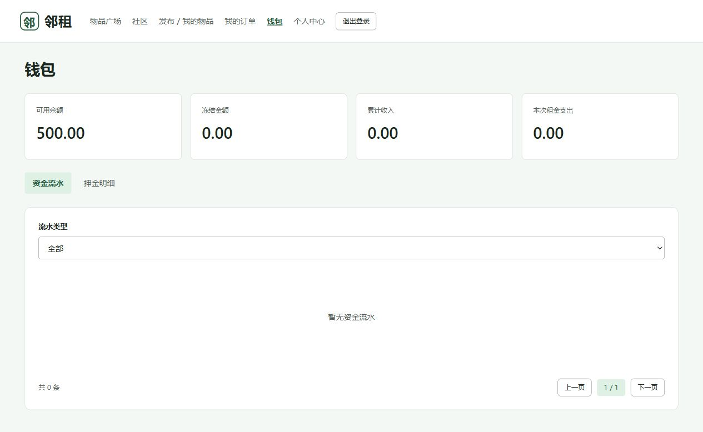
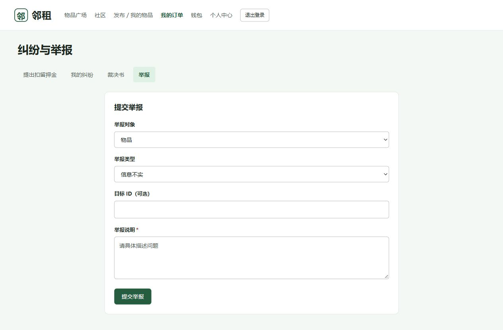

# 邻租用户手册

| 文档信息 | 内容 |
| --- | --- |
| 文档版本 | V0.1 |
| 作者 | 林星 |
| 所属基线 | 发布基线-v1.0 |
| 编写日期 | 2026-11-13 |
| 最后更新 | 2026-11-14 |

**修订历史**

| 日期 | 版本 | 修订内容 | 作者 |
| --- | --- | --- | --- |
| 2026-11-13 | V0.1 | 编写用户与管理员操作说明、常见问题和当前版本限制 | 林星 |

**阅读导航**

1. 使用前须知
2. 账号与个人中心
3. 社区
4. 查找和收藏物品
5. 发布和管理自己的物品
6. 租赁与订单
7. 钱包与纠纷
8. 管理员操作
9. 常见问题

## 1 使用前须知

邻租用于在社区内共享和租赁闲置工具。本手册介绍从注册账号、加入社区、发布或租用物品，到取还物、结算和处理纠纷的操作。用户阅读第 2 至第 7 章；社区管理员和平台管理员另阅读第 8 章。

### 1.1 访问系统

使用浏览器打开项目部署人员提供的网址。采用项目默认 Docker 部署时，本机入口为 `http://localhost/`；采用本地开发方式时，入口通常为 `http://localhost:5173/`。前端页面与后端服务都需启动。正式使用时请以部署地址为准。

页面顶部为主导航，包含物品广场、社区、发布 / 我的物品、我的订单和钱包。未登录时显示“登录 / 注册”；登录后可进入个人中心或退出登录。管理员账号还会显示相应管理入口。

### 1.2 角色与操作权限

| 角色 | 主要操作 |
| --- | --- |
| 游客 | 浏览物品，查看物品详情；收藏、订单等个人功能需登录 |
| 注册用户 | 管理个人资料、申请实名认证、查看本人账户信息 |
| 认证用户 | 加入社区，发布和管理自己的物品，使用租赁相关功能 |
| 社区管理员 | 审核加入申请、管理成员和公告、处理举报及社区纠纷 |
| 平台管理员 | 管理社区和用户、配置平台参数、查看统计与日志、处理仲裁 |

“租客”和“出租者（物主）”是针对某笔订单的身份，同一账号可以租入别人的物品，也可以出租自己的物品。只能操作本人有权限的记录。

### 1.3 一次租赁的主要步骤

租客：登录并加入物品所属社区 → 查找物品 → 选择租期并创建订单 → 支付 → 等待接单 → 出示取物码 → 使用 → 上传凭证并发起归还 → 等待验收 → 查看结算并评价。

出租者：完成认证并加入社区 → 发布物品 → 等待审核上架 → 接单 → 核销取物码并上传凭证 → 确认收到归还 → 验收结算；存在押金争议时，进入纠纷流程。

## 2 账号与个人中心

### 2.1 注册与登录

1. 点击顶部“登录 / 注册”。已有账号选择“账号登录”，新用户选择“注册账号”。
2. 注册时填写用户名、密码和确认密码；昵称可选，不填时使用用户名。用户名为 3 至 20 位中文、字母、数字或下划线，密码为 6 至 32 位。
3. 登录时填写用户名或已绑定的手机号、密码和图形验证码。验证码看不清或已失效时，点击验证码图片刷新。
4. 点击提交按钮。成功后进入系统；若原先因访问个人功能被要求登录，系统会返回相应页面。

输入有误时按页面提示修改。登录失败后验证码可能刷新，应填写新图片中的字符。忘记密码时联系平台管理员，当前登录页没有自助找回密码入口。

### 2.2 查看和修改资料

1. 登录后点击顶部个人中心入口，在“我的资料”查看昵称、角色、认证状态、信用分和账户信息。
2. 切换“编辑资料”，修改昵称、个人简介，点击“保存资料”。昵称不超过 30 字，简介不超过 255 字。
3. 如需更换头像，使用头像旁的上传按钮选择图片。支持 JPG、PNG、GIF 和 WebP，大小不超过 2MB；头像上传成功后立即更新。
4. 在“账号与安全”填写原密码、新密码和确认新密码，点击“修改密码”。两次新密码必须一致。

### 2.3 实名认证

1. 在个人中心选择“实名认证”。
2. 未认证或认证被驳回时，填写真实姓名和 18 位身份证号，点击“提交认证申请”。
3. 提交后查看“审核中”状态；审核通过后显示“已实名认证”。被驳回时按反馈修改后重新申请。

审核中和已通过的账号不能重复提交。发布物品前必须完成认证。当前管理页面尚无实名认证审核入口；申请长期处于审核中时，由部署维护人员协助联系审核负责人。

### 2.4 退出登录

点击顶部“退出登录”。成功后导航恢复“登录 / 注册”，再次访问订单、钱包等个人页面需重新登录。共用电脑使用结束后应退出。

## 3 社区

### 3.1 查找和加入社区

1. 登录后点击“社区”，在“发现社区”输入社区名称筛选。
2. 进入目标社区主页，查看公告、社区信息及物品。
3. 点击“申请加入”。若显示“待审核”，等待社区管理员处理；若直接显示“已加入”，则已获得成员资格。
4. 在“我的社区”查看成员关系及申请时间。

发布物品时只能选择已加入的社区。租用社区物品时也会检查成员资格；可以看到某社区的物品，不代表已经可以下单。

### 3.2 查看社区内容

从“发现社区”或“我的社区”进入“社区主页”，查看公告、置顶推荐及最新上架物品，点击物品进入详情。未选社区时，先返回“发现社区”选择。

当前“退出社区”按钮处于禁用状态，网页端暂不提供退出操作。

## 4 查找和收藏物品

### 4.1 筛选物品

1. 点击“物品广场”，选择“浏览物品”。
2. 选择社区范围，按需填写关键词、分类、最低和最高日租金。
3. 点击“搜索”；也可切换排序方式和每页数量。支持最新发布、价格从低到高、价格从高到低和最热排序。
4. 点击物品卡片查看详情。需要重新查找时点击“清除筛选”。

“已加入社区”用于浏览本人社区的物品；尚未加入社区时会显示全部范围。需要查看其他社区时可主动选择“全部社区”或某个社区。无结果时先清除筛选，检查价格上下限和关键词。

### 4.2 物品详情与可租日历

详情页展示图片、日租金、押金、成色说明、物品描述、租用评价和可租日历。点击缩略图可切换主图；日历可通过“上个月”“下个月”“本月”切换。

日历中浅色日期表示已过去，划线日期表示已占用，其他日期可供选择。物品存在尚未结束的租赁时，后续可租时间可能需要等待归还与验收后确认。实际能否下单以提交时的检查结果为准。

### 4.3 收藏

登录后，在详情页点击“收藏”；已收藏的物品可再次点击取消。回到物品广场，切换“我的收藏”查看收藏列表。收藏不占用租期，也不代表已创建订单。

## 5 发布和管理自己的物品

### 5.1 发布物品

前提：已登录、已通过实名认证，并已加入至少一个社区。

1. 点击顶部“发布 / 我的物品”，进入发布页。
2. 选择所属社区和分类，填写标题、日租金、押金、成色说明和物品描述。带星号的项目必须填写。
3. 日租金最低为 0.01 元，押金可为 0，金额最多保留两位小数。说明中写清用途、配件和使用注意事项。
4. 添加至少一张物品图片，支持 JPG、PNG 和 WebP。检查预览，移除误选图片后再提交。
5. 点击“提交审核”。成功后进入“我的物品”，查看审核状态；通过审核后物品才能上架供他人租用。

信用分低于 60 时，不能发布押金超过 500 元的物品。当前页面标注图片上限 5MB，但默认后端上传限制为 2MB；初次使用建议每张图片小于 2MB，上传失败时先压缩图片。

当前管理页面尚无物品审核入口。发布后一直“待审核”时应联系审核负责人，不要重复发布同一物品。

### 5.2 编辑和上下架

1. 在发布页点击“我的物品”，可按物品状态筛选。
2. 找到目标物品，点击“编辑”，修改后提交。编辑提交后会重新进入审核流程。
3. 暂时不出租时点击“下架”；符合条件的已下架物品可点击“重新上架”。待审核、驳回或违规下架等状态以页面允许的操作为准。
4. 确定不再保留的物品可点击“删除”，阅读确认提示后再确认。页面提示删除后无法恢复。

管理物品前先核对关联订单，避免在尚需交接或归还时误删物品。操作失败时按页面提示检查权限和物品状态。

## 6 租赁与订单

### 6.1 创建订单

前提：已登录、已加入物品所属社区，物品已上架且不属于本人。信用分低于 40 时暂不能租用物品。

1. 在物品详情的租用区域选择开始日期和结束日期。开始日期不能早于当天，结束日期不能早于开始日期。
2. 查看租期、租金、押金和合计金额。租期包含首尾两天，例如 20 日至 22 日按 3 天计算。
3. 点击“立即租用”。成功后进入订单详情，状态为“待支付”。创建订单本身不代表支付完成。
4. 若提示租期重叠或物品不可用，返回详情调整日期或选择其他物品。

### 6.2 支付与接单

租客在订单详情核对物品、租期和金额，点击“确认支付”。当前系统使用站内钱包余额，支付会冻结租金与押金；成功后进入“待接单”。余额不足时先停止重复提交，联系演示环境维护人员处理余额；钱包页没有充值或提现入口。

出租者进入“我的订单”，切换“我租出的”，打开对应订单详情，点击“确认接单”。接单成功后进入“待取物”，系统生成取物码。无法出租时点击“拒绝接单”并填写原因，订单取消并按规则退回已冻结资金。

### 6.3 查看和取消订单

进入“我的订单”，按“我租入的”或“我租出的”查看记录，可按订单状态搜索。点击记录右侧操作链接进入详情，查看费用、时间记录、交接凭证和留言。

当前列表部分标签与详情不一致：列表的“待确认”对应详情“待支付”；列表的“确认支付”对应详情“待接单”。操作时以订单详情的状态和可用按钮为准，不要依据列表旧文案重复支付。

租客可在详情仍显示“取消订单”时取消待支付或待接单订单，填写取消原因并确认。取消后核对订单状态；已经支付的订单还应核对钱包解冻记录。进入后续阶段后不要假定仍可自行取消。

### 6.4 取物交接

1. 租客打开“待取物”订单详情，现场向出租者出示取物码。
2. 双方检查物品外观、配件与功能。
3. 出租者打开同一订单，输入租客出示的取物码，选择至少一张“取物凭证”图片。
4. 点击“核销并交接”。成功后订单变为“租用中”，双方可在“取还物凭证”查看记录。

取物码只在相应订单和阶段有效。提示错误时核对订单与验证码，不要在未实际交接时核销。

### 6.5 归还与验收

1. 租客归还物品时，在“租用中”订单上传至少一张“归还凭证”，点击“发起归还”，进入“待归还”。
2. 出租者实际收到物品后，点击“确认收到归还”，进入“待验收”。
3. 出租者检查配件、功能和损坏情况。无问题时点击“验收通过并结算”，订单变为“已完成”。
4. 有问题时点击“验收不通过”，填写原因，订单进入“纠纷中”。需提出押金扣留方案时，继续按第 7 章操作。

正常结算时，租金按平台佣金规则结算给出租者，押金按结果解冻。逾期会显示逾期天数和费用；当前逾期费按日租金的 1.5 倍乘以逾期天数计算，实际从押金中扣除的金额以订单结算记录为准。完成后到钱包核对流水。

### 6.6 留言和评价

在订单详情底部“订单留言”输入与交接相关的信息并发送，可查看双方留言。留言不能代替取物核销、归还或验收操作。

订单完成后 7 天内，在“订单评价”选择 1 至 5 星，按需填写评价内容（最多 500 字），点击“提交评价”。评价会按规则影响被评价人的信用分。每方对同一订单只能评价一次；收到重复评价或评价窗口关闭提示时不要反复提交。

### 6.7 状态与下一步

| 详情状态 | 下一步操作人 | 下一步 |
| --- | --- | --- |
| 待支付 | 租客 | 核对金额并支付，或取消 |
| 待接单 | 出租者 | 接单或填写原因拒单 |
| 待取物 | 双方 | 租客出示取物码，出租者上传凭证并核销 |
| 租用中 | 租客 | 到期归还并上传凭证 |
| 待归还 | 出租者 | 确认实际收到物品 |
| 待验收 | 出租者 | 验收通过结算，或说明不通过原因 |
| 已完成 | 双方 | 核对钱包并评价 |
| 已取消 | 双方 | 查看原因；已支付的订单核对资金退回 |
| 纠纷中 | 双方及管理人员 | 查看押金争议、回应、调解或仲裁进度 |

当前默认超时规则为：待支付 15 分钟后取消；待接单 24 小时、待取物 48 小时后取消并退款；待归还或待验收达到配置的 7 天时自动验收结算。具体执行时间受服务端定时任务和部署配置影响，应及时处理订单。

## 7 钱包与纠纷

### 7.1 查看钱包

点击“钱包”，查看余额、冻结金额和汇总信息。切换“资金流水”，可按收入、支出、冻结、解冻筛选；有关联订单的流水可进入“订单详情”。切换“押金明细”查看订单押金金额、状态与时间。

冻结表示资金暂时不可用，不等于最终支付给出租者。取消、验收结算或纠纷处理后，应同时核对订单和流水。当前页面不提供充值、提现或绑定银行卡功能。

### 7.2 出租者提出扣留押金

入口：“我的订单”右上角“提出扣留押金 / 举报” → “提出扣留押金”。

1. 选择本人作为物主的关联订单，核对自动带入的社区、租客、押金和租金。
2. 填写扣留金额与具体理由。金额必须大于 0，且不能超过该订单押金。
3. 点击“提出扣留押金”。成功后在“我的纠纷”查看状态，等待租客回应。

当前允许发起的订单阶段为租用中、待归还、待验收或纠纷中。一个订单只能发起一次纠纷，已经发起过的记录不能再次提交。

### 7.3 租客回应及查看结果

1. 进入“纠纷与举报” → “我的纠纷”，打开“查看详情”。
2. 核对订单、扣留金额和理由。在“待租客回应”时，可以选择“同意，立即和解”，或填写异议理由后点击“不同意，申请调解”。
3. 同意后执行和解结算；不同意后进入社区调解。处理期间可在详情查看状态和处理记录。
4. 调解未解决并进入平台仲裁后，等待平台处理。已裁决的记录可在“裁决书”页选择“查看裁决书”，查看理由、赔付出租者金额、退回租客押金和执行结果。
5. 和解、调解或裁决完成后，到钱包核对资金变化。

确认和解前务必核对扣留金额，因为该操作会执行资金划转。

### 7.4 举报问题

在“纠纷与举报”选择“举报”，选择物品、用户或评价作为举报对象，再选择信息不实、违规内容、恶意评价或其他类型。填写目标 ID（可选）和具体说明，点击“提交举报”。成功后显示“举报已提交”。

举报用于反映违规内容；押金争议应走纠纷流程。当前页面提供举报提交入口，未提供“我的举报记录”列表。

## 8 管理员操作

### 8.1 社区管理

使用有对应社区权限的管理员账号登录，点击“社区管理”。确认当前社区名称后，再进行以下操作。

**审核加入申请**：选择“加入申请”，按审核状态筛选。核对申请人后点击通过；拒绝时可填写原因并点击“确认拒绝”。处理后检查申请状态。

**管理成员**：切换“成员管理”，查看成员及角色。需要移出成员时，核对账号后使用移出操作，确认列表更新。

**发布公告**：切换“公告管理”，填写标题和正文，配图地址可选，点击“发布”。在“已发布公告”核对内容；删除前确认该公告确已不再需要。

**处理举报**：切换“举报处理”，查询待处理记录。核对举报对象、类型与说明，选择“驳回举报”“下架物品”“警告当事人”或“移交封禁”，填写处理意见后点击“确认处理”。结果以处理记录为准；移交封禁不应视为已经完成账号封禁。

### 8.2 调解工作台

1. 进入“调解工作台”，按纠纷状态筛选，打开纠纷详情。
2. 核对订单、争议金额和双方意见，在“调解留言”填写说明并发送，保留处理记录。
3. 达成一致时填写“调解结论”和“扣除给物主的押金金额”，核对后点击“标记调解成功”。金额不能超过押金。
4. 无法达成一致时，填写“上报仲裁说明”，点击“上报平台仲裁”，确认进入待仲裁状态。

调解成功会按填写金额结算。只处理本人有权限的纠纷，提交前再次核对订单和金额。

### 8.3 平台社区与用户管理

平台管理员点击“平台管理”。

**社区管理**：填写社区名称、简介、封面图地址和状态，点击“保存”新增社区；修改时在社区列表点击“编辑”。在“任命管理员”中选择认证用户并确认；需要解除任命时使用“罢免”。操作前核对社区和目标用户。

**用户管理**：按账号、昵称或状态搜索，查看用户信息。需要封禁时选择用户，填写原因后点击“确认封禁”；需要恢复时使用对应解封操作。避免对错选的账号提交管理操作。

**参数配置**：检查平台佣金比例，输入 0 至 0.5 之间的数值，点击“保存配置”。例如 0.1 表示 10%。修改前确认适用的结算规则。

**数据统计和操作日志**：切换相应页签查看统计。操作日志可按操作类型查询，用于核对管理员操作是否已被记录。

### 8.4 平台仲裁

1. 由平台管理员进入“仲裁中心”，选择待仲裁纠纷并查看详情。
2. 核对双方意见、押金金额和处理记录，选择全退租客、部分扣除或全额扣除。
3. 选择部分扣除时填写划付出租者的金额，且不能超过押金；填写裁决理由。
4. 核对后点击“提交裁决并划转资金”。成功后查看裁决书及资金分配结果。

这是执行结算的操作，不是保存草稿。已裁决记录不可重复裁决。

## 9 常见问题

### 9.1 页面能打开但没有数据

先检查是否出现加载失败提示，再使用“重新加载”。只有页面框架不代表后端已启动。持续失败时向维护人员提供页面名称、操作时间和错误文字，不要重复提交发布、付款或裁决操作。

### 9.2 发布页没有可选社区

检查是否已登录、已认证，并在“我的社区”确认状态为“已加入”。“待审核”的申请不算有效成员；审核后可重新加载社区列表。

### 9.3 已发布的物品没有出现在广场

在“我的物品”查看是否待审核、被驳回或已下架，再检查广场筛选范围。仅提交成功不代表已审核上架。

### 9.4 日历没有划线或整月被占用

没有划线可能是该物品本月没有占用记录。整月显示占用时，检查是否存在未结束的租赁以及日历下方提示，等待归还验收后再确认可租时间。

### 9.5 找不到接单或归还按钮

先在“我租入的”和“我租出的”之间确认身份，再进入详情核对当前状态。接单、核销、确认收到归还、验收由出租者操作；支付、出示取物码、发起归还由租客操作。

### 9.6 上传失败

检查图片格式、大小和网络。头像不超过 2MB；物品和交接凭证在当前默认环境下也建议使用小于 2MB 的图片。等待明确结果后再重试，避免误以为选择文件就已提交。

### 9.7 提示登录过期或无权限

登录过期时重新登录。无权限时确认账号角色、社区归属和订单参与身份；管理员页面需要对应授权，不能仅靠输入网址获得权限。

### 9.8 状态没有按预期变化

刷新详情，检查错误提示和时间记录。对支付、结算、和解或裁决操作，先查钱包流水再决定是否重试。仍有疑问时记录订单编号或纠纷编号，联系管理员处理。
